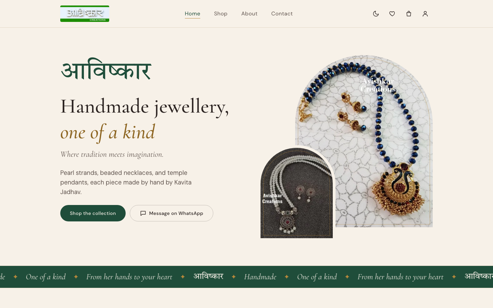
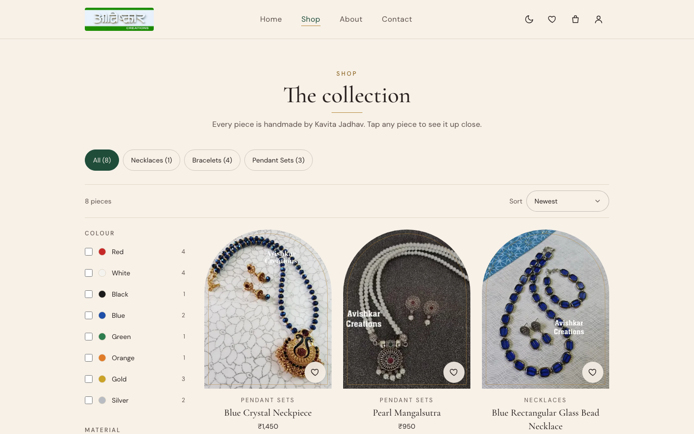
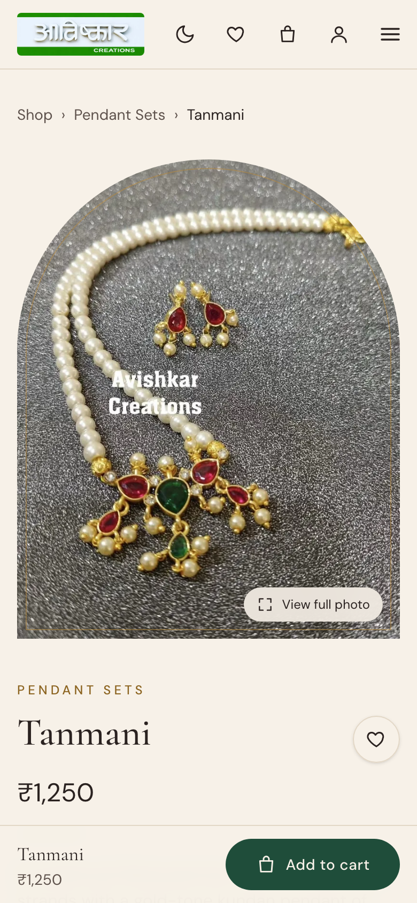
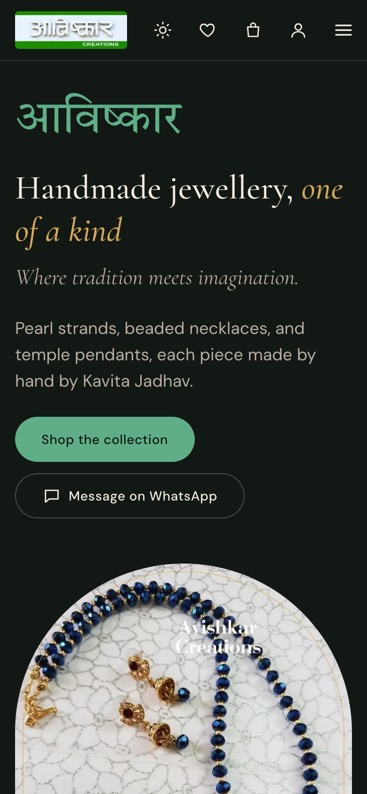
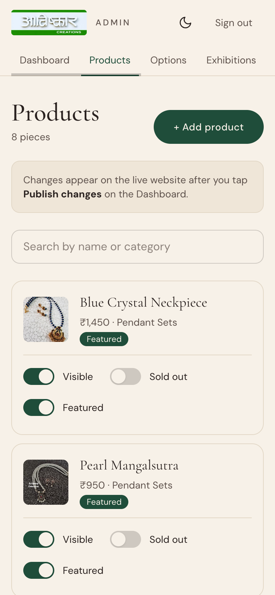
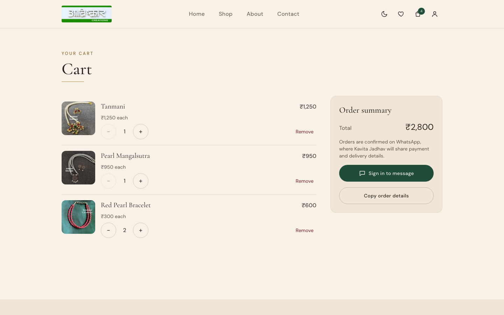
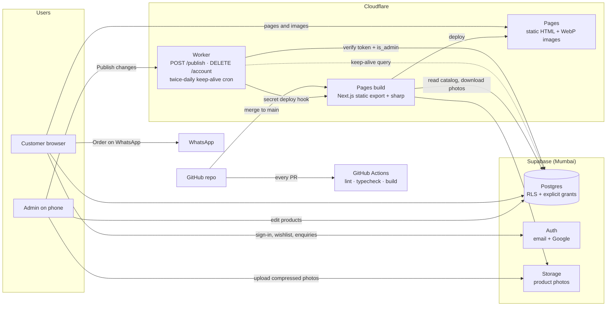

# Avishkar Creations · आविष्कार

**Handmade jewellery, one of a kind.** A website for my mother Kavita Jadhav's handmade jewellery business in Pune, India, built as a surprise for her, and as a full-stack portfolio project.

**Live site:** https://avishkar-creations.pages.dev


My mother sells her handmade pearl, bead, and temple jewellery at exhibitions and on Instagram. This site gives her a shop she can run entirely from her phone: she adds pieces, uploads photos, and taps **Publish**, and customers browse, save favourites, and order on WhatsApp. It runs completely free, and the storefront stays online even if the database is unavailable.

---

## Screenshots

| Home (desktop) | Shop with filters |
|---|---|
|  |  |

| Product page (mobile) | Dark theme (mobile) | Admin: products (mobile) |
|---|---|---|
|  |  |  |

| Cart with order summary |
|---|
|  |

---

## Architecture



**How it fits together:** customers load pre-built static pages from Cloudflare's CDN (with servers across India). Only interactive features (sign-in, wishlist, contact form, admin) talk to Supabase from the browser, protected by Row Level Security. When my mother taps **Publish**, the Worker verifies she's an admin and triggers a rebuild, which fetches the latest catalog, optimises the photos, and deploys new static pages in about two minutes.

---

## Key engineering decisions

**Static-first, so the shop never goes down.** The storefront is a Next.js static export served from Cloudflare Pages. Products and photos are baked in at build time, so browsing, the cart, and WhatsApp ordering keep working even if the free Supabase project pauses. A failed build leaves the last good deployment live.

**Security lives in the database, not the UI.** Every table has Row Level Security plus explicit grants (automatic table exposure is disabled), so the public key can only do what the policies allow. Admins are an allowlist keyed by user ID, checked by an `is_admin()` function, and I tested the rules with the public key to confirm private tables return "permission denied". Customers can only read and change their own profile and wishlist.

**Schema drift fails the build.** All data fetched at build time is validated with Zod. If the database and code disagree, the build fails loudly instead of publishing broken pages, and the previous version stays live.

**An image pipeline built for phones and mobile data.** Photos are compressed in the admin's browser before upload (to about 0.6 MB). At build time, sharp creates responsive WebP sizes (400/800/1200px) and a 1200×630 JPEG link preview per photo, using an attention-based crop to keep the jewellery in frame.

**Secrets stay server-side.** A Cloudflare Worker holds the Pages deploy hook and the Supabase secret key. It verifies the caller's token with Supabase before publishing or deleting an account, refuses to delete admin accounts, and only accepts requests from the site's own origins. It also runs a twice-daily keep-alive query so the free database doesn't pause.

**Fail-open where it matters.** The optional "sign in to message" rule is read live from the database. If the setting can't be loaded, customers can still message and order: availability beats enforcement for a small business.

**Phone-first and accessible.** The admin is designed for a phone (large tap targets, camera upload, one-tap Publish). The site uses semantic HTML, keyboard-friendly dialogs, `prefers-reduced-motion`, and light and dark themes built on semantic colour tokens that meet WCAG AA contrast, with no theme flash on load.

---

## Features

**Storefront**
- Home page with hero, featured pieces, collections, the maker's story, and upcoming exhibitions
- Shop with category, colour, and material filters plus sorting, synced to the URL so filtered views can be shared
- Product pages with a gallery, full-photo viewer, and structured data (price and availability) for search engines
- Cart saved in the browser, with "Order on WhatsApp" prefilled with every item, link, and the total
- Link previews on WhatsApp and Instagram, a sitemap, robots.txt, and a branded 404 page

**Customer accounts**
- Sign up with email (verified) or Google
- Wishlist saved to the account, account page with profile, password, email change, and account deletion
- Privacy policy

**Admin (phone-first)**
- Products: add, edit, hide, mark sold out or featured, with photo upload, reordering, and descriptions
- Categories, colours (with swatches), and materials
- Exhibitions and contact-form enquiries (reply on WhatsApp in one tap)
- Settings, a Publish button, and secure password reset with single-use, 1-hour links

---

## Tech stack

| Area | Tools |
|---|---|
| Frontend | Next.js 16 (App Router, static export), React 19, TypeScript (strict), Tailwind CSS v4, Motion |
| Backend | Supabase: Postgres with Row Level Security, Auth (email + Google), Storage |
| Edge | Cloudflare Pages (hosting, preview deployments), Cloudflare Workers (publish, account deletion, cron) |
| Images | sharp at build time, browser-image-compression in the admin |
| Validation | Zod for build-time data and forms |
| CI/CD | GitHub Actions (lint, typecheck, build on every PR), branch protection, Cloudflare auto-deploys from `main` |
| Email | Gmail SMTP for auth emails, with branded templates |

---

## Project structure

```
avishkar-creations/
├── web/                     Next.js app (storefront, customer accounts, admin)
│   ├── scripts/             prepare-images.mts: downloads and optimises photos before each build
│   └── src/
│       ├── app/(site)/      storefront pages (shop, product, cart, wishlist, account, about, contact)
│       ├── app/admin/       admin dashboard (products, options, exhibitions, enquiries, settings)
│       ├── components/      UI components (admin/, auth/, shop/, account/)
│       └── lib/             data layer, cart store, Supabase clients, helpers
├── worker/                  Cloudflare Worker (publish, account deletion, keep-alive cron)
├── supabase/
│   ├── migrations/          versioned SQL, applied in order
│   └── seed.sql             starter categories (plus sample data files)
└── .github/workflows/       CI
```

---

## Running locally

**Prerequisites:** Node.js 20+, a Supabase project, and (for publishing) a Cloudflare account.

1. **Database:** in the Supabase SQL editor, run the files in `supabase/migrations/` in order, then `supabase/seed.sql`. Create admin accounts under Authentication → Users, then add them to the allowlist (see the comment in `0004_admins_by_user_id.sql`).
2. **Environment:** copy `web/.env.example` to `web/.env.local` and fill in your Supabase URL and publishable key. The Worker URL and WhatsApp number are optional.
3. **Run the site:**
   ```bash
   cd web
   npm install
   npm run dev
   ```
   Product photos are downloaded and optimised automatically before the dev server starts.
4. **Worker (optional):** in `worker/`, run `npm install`, set `DEPLOY_HOOK_URL` and `SUPABASE_SECRET_KEY` with `npx wrangler secret put`, then `npm run deploy`.

---

## What's next

- Custom `.com` domain and a branded email sender
- Online payments with Razorpay and an orders table (the schema is designed for it)
- An AWS Lambda image processor (Node.js + sharp, deployed with AWS SAM) to create image variants at upload time

---

Built with love for my mother by [Saniya Jadhav](https://github.com/saniyajadhav12).